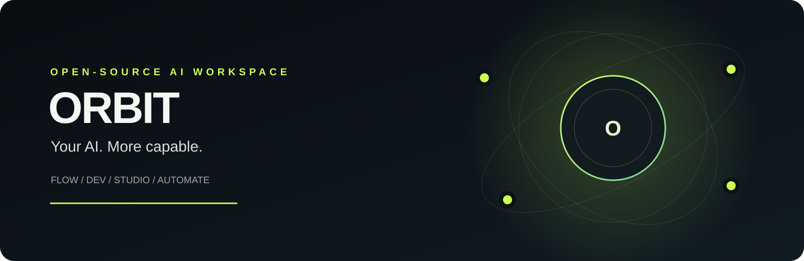
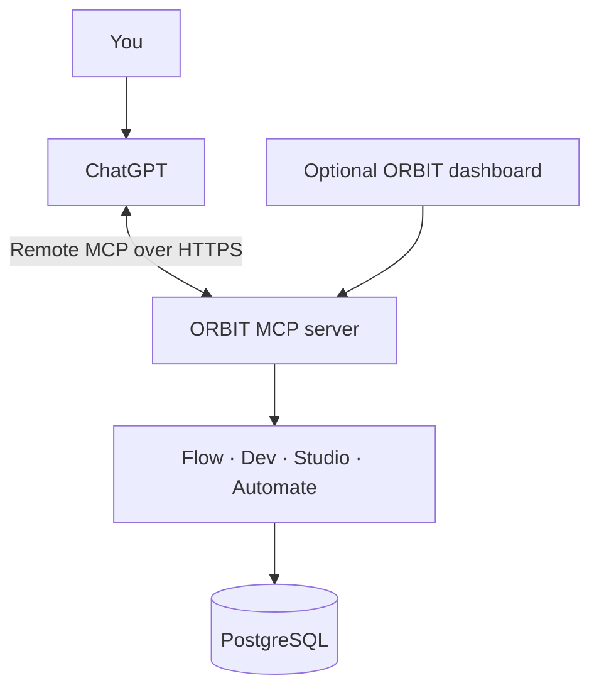

<!-- ORBIT — README | ChatGPT-first open-source workspace -->

  
  
<strong>One workspace. Four focused engines. Open by design.</strong>

  

    
    
    
  

---

## ◈ What is ORBIT?

**ORBIT is an open-source capability layer that gives a compatible AI client a focused set of tools for planning, building, creating, and automating work. ChatGPT is the intended primary interface.**

ORBIT is organised as four engines:

- **Flow** — projects, tasks, research, and working context.
- **Dev** — repository inspection, code-risk heuristics, API checks, and error analysis.
- **Studio** — design briefs, website plans, component specifications, and content packs.
- **Automate** — saved workflows composed from explicitly allowlisted ORBIT actions.

The goal is simple: work with ORBIT from ChatGPT instead of having to use a separate ORBIT dashboard for everyday tasks. The dashboard in this repository is an optional administration/demo interface, not the intended primary user experience.

## ✳ ChatGPT-first, not a second AI subscription

ORBIT's core tools do **not** call a separate paid AI API. ChatGPT supplies the conversational reasoning; ORBIT supplies the tools, persistent records, and controlled actions through the Model Context Protocol (MCP).

That does not mean ChatGPT hosts ORBIT's backend. A remote MCP server and a database still need to run somewhere. ORBIT uses standard open-source components and can be self-hosted. A free hosting/database combination may be used for a ₹0 demo, but those providers are infrastructure dependencies—not part of ChatGPT—and their free tiers have limits.

**ChatGPT plan compatibility is a separate requirement.** Custom remote MCP apps/connectors and write permissions depend on the ChatGPT plan, client features, and workspace settings. ORBIT cannot unlock or bypass those restrictions. Check [ChatGPT connection requirements](docs/CHATGPT-SETUP.md) before deploying. In particular, do not assume a Go account can connect a custom write-capable MCP server.

## ◈ The four engines

| Engine | Capabilities |
|---|---|
| **Flow** | Create/list projects and tasks, update task status, save and search research |
| **Dev** | Inspect public GitHub repositories, run heuristic code checks, test public HTTP APIs, explain error logs |
| **Studio** | Save design briefs, plan website structure, specify components, draft content packs |
| **Automate** | Create, validate, list, and execute workflows built from allowlisted Flow/Studio actions |

These are tool capabilities, not claims that ORBIT autonomously performs every action in an external service. For example, repository analysis is not the same as committing code or opening pull requests.

## ⌁ Architecture

- **ChatGPT** is the intended conversational interface and model.
- **ORBIT MCP server** exposes the engine tools.
- **PostgreSQL** stores projects, tasks, research, briefs, workflows, executions, and audit records.
- **Dashboard** is optional; it is not required for ChatGPT tool use.

## 💸 ₹0 deployment target

The project is designed to be deployable on free tiers for personal testing and demos:

| Layer | Candidate | Reality |
|---|---|---|
| Source and CI | GitHub | Free allowances and usage limits apply |
| MCP server | Render Free Web Service | Sleeps when idle; cold starts; no production SLA |
| PostgreSQL | Neon Free | Quotas and provider policies apply |
| AI reasoning | Existing ChatGPT account | No separate ORBIT model API key; MCP access depends on ChatGPT plan |

This is a **₹0 target, not a guarantee**. Free tiers can change, pause, or impose limits. Do not add a payment method if the hard budget is zero. See [zero-budget deployment](docs/ZERO-BUDGET-DEPLOYMENT.md).

## ⚠️ Current release limitations

ORBIT is early development. The repository has a working source structure and CI build, but a green build is not proof of a successful live ChatGPT connection.

- Authentication currently uses a single-owner bearer token. It is not OAuth 2.1 and is not a public multi-user SaaS.
- The current server maps requests to one configured owner ID. Do not share a token with unrelated users.
- ChatGPT custom MCP connection and write-action availability must be confirmed for the account/workspace being used.
- Hosted database migrations, live MCP tool calls, and end-to-end ChatGPT interaction still require verification.
- Free hosting may sleep and cold-start. No uptime guarantee is made.

Never publish `.env`, database URLs, API tokens, or private repository credentials.

## 🚀 Source and development

The source is in this repository. Contributors may run it locally, but **local Node/PostgreSQL setup is not required for an end user of a hosted ChatGPT-connected ORBIT instance**.

- [Installation and contributor setup](docs/INSTALLATION.md)
- [ChatGPT connection guide](docs/CHATGPT-SETUP.md)
- [Zero-budget deployment](docs/ZERO-BUDGET-DEPLOYMENT.md)
- [Operations](docs/OPERATIONS.md)
- [Security](SECURITY.md)
- [Roadmap](ROADMAP.md)

## 🧪 Verification status

The GitHub Actions workflow currently verifies dependency installation, TypeScript type-checking, and production builds. It does not yet verify a deployed database, every engine operation, or a live ChatGPT MCP session.

[View latest CI runs](https://github.com/ansh385/orbit/actions).

## 🗺 Roadmap

- [x] Define Flow, Dev, Studio, and Automate
- [x] Publish application source and MCP tool definitions
- [x] Add CI install, type-check, and build checks
- [ ] Run database migrations on a clean hosted database
- [ ] Add meaningful engine and MCP protocol integration tests
- [ ] Implement secure per-user authentication and tenant isolation
- [ ] Verify a live remote MCP connection in a ChatGPT account that supports it
- [ ] Publish a reproducible release

## 🤝 Contributing

Read [CONTRIBUTING.md](CONTRIBUTING.md), check [ROADMAP.md](ROADMAP.md), and open an issue before large changes. Do not include secrets, tokens, or private data in issues or pull requests.

## 📄 License

MIT — see [LICENSE](LICENSE).

  <strong>ORBIT</strong> 
  One workspace. Four engines. ChatGPT-first. Built in the open.  
  <a href="https://github.com/ansh385/orbit">Repository</a> ·
  <a href="https://github.com/ansh385/orbit/issues">Issues</a>

