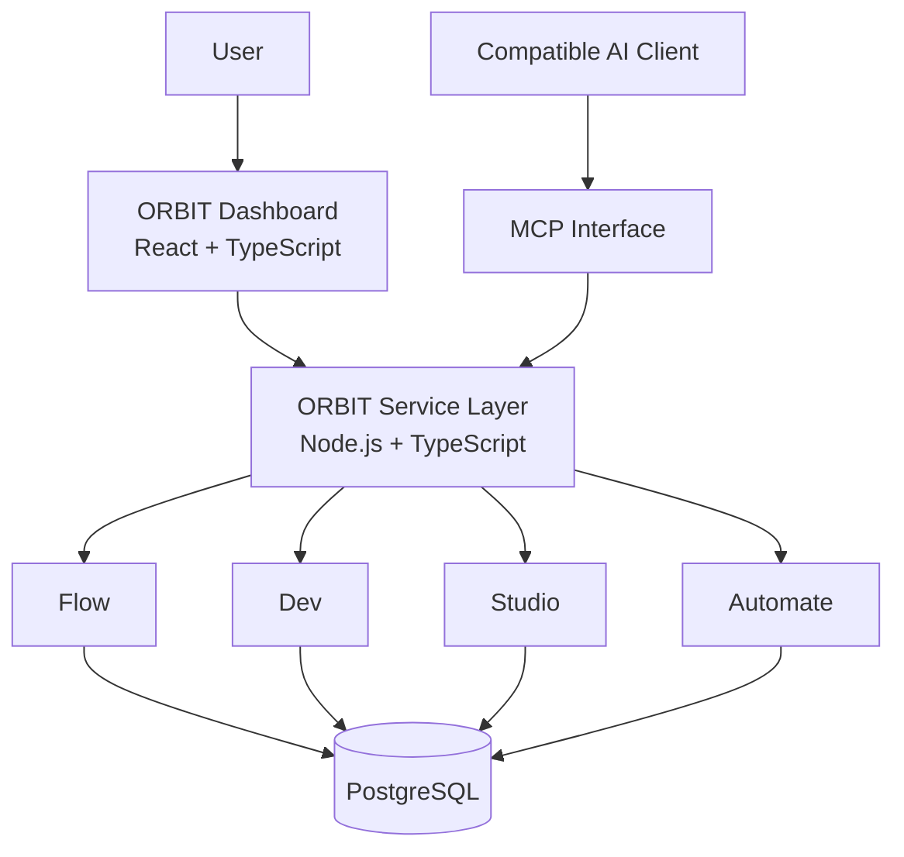

<!-- ORBIT — README | Premium project overview -->

  

  
<strong>One workspace. Four focused engines. Open by design.</strong>

  

    
    
    
  

  

    <a href="#-what-is-orbit">Explore</a> ·
    <a href="#-the-four-engines">Engines</a> ·
    <a href="#-architecture">Architecture</a> ·
    <a href="#-documentation">Documentation</a> ·
    <a href="#-roadmap">Roadmap</a>
  

---

## ◈ What is ORBIT?

**ORBIT is an open-source, self-hosted AI workspace designed to turn a general-purpose assistant into a set of focused tools for getting work done.**

Instead of scattering capabilities across disconnected apps, ORBIT brings four engines into one platform:

- **Flow** to organise projects, tasks, and research.
- **Dev** to help inspect repositories and reason about code.
- **Studio** to shape design, product, and content work.
- **Automate** to compose repeatable workflows from controlled actions.

ORBIT is being built around the [Model Context Protocol (MCP)](https://modelcontextprotocol.io/), with a React dashboard and PostgreSQL-backed services.

> **Project status:** early development. The repository is currently being assembled; the complete application source, runnable release, and end-to-end verification are not yet published here. Documentation describes the intended setup and direction, not a claim that every feature is production-ready.

## ✳ The four engines

<table>
  <tr>
    <td width="50%" valign="top">
      <h3>◉ FLOW</h3>
      
<strong>Think clearly. Keep moving.</strong>

      A workspace for project context, tasks, planning, and research.
      <ul>
        <li>Project and task organisation</li>
        <li>Research and structured notes</li>
        <li>Context that stays connected to the work</li>
      </ul>
    </td>
    <td width="50%" valign="top">
      <h3>⌘ DEV</h3>
      
<strong>Understand the codebase.</strong>

      Developer-focused tools for inspecting and reasoning about software.
      <ul>
        <li>Repository inspection</li>
        <li>Code review assistance</li>
        <li>API and error analysis</li>
      </ul>
    </td>
  </tr>
  <tr>
    <td width="50%" valign="top">
      <h3>✧ STUDIO</h3>
      
<strong>Turn ideas into clear specifications.</strong>

      A creative and product-planning space for shaping deliverables.
      <ul>
        <li>Design and product briefs</li>
        <li>Website and component specifications</li>
        <li>Structured content packs</li>
      </ul>
    </td>
    <td width="50%" valign="top">
      <h3>↗ AUTOMATE</h3>
      
<strong>Make repeatable work reusable.</strong>

      A workflow layer built around explicitly allowed ORBIT actions.
      <ul>
        <li>Reusable workflow definitions</li>
        <li>Allowlisted action execution</li>
        <li>Human-controlled operation boundaries</li>
      </ul>
    </td>
  </tr>
</table>

## ⌁ Why ORBIT?

| Principle | What it means |
|---|---|
| **One platform** | Four focused engines share a common foundation. |
| **Open source** | MIT-licensed project with a public development path. |
| **Self-hosted first** | Keep deployment and data under your control. |
| **MCP-native direction** | Designed to connect AI clients through a standard tool interface. |
| **Guardrails matter** | Automation should use explicit permissions and controlled actions. |

## ⌘ Architecture

The target architecture separates the user interface, service layer, data store, and MCP integration.

Conceptual target architecture; implementation details may evolve during development.

## ⚙️ Technology direction

| Layer | Technology |
|:--|:--|
| Dashboard | React · TypeScript · Vite |
| Backend | Node.js · TypeScript |
| AI integration | Model Context Protocol (MCP) |
| Database | PostgreSQL |
| Local deployment | Docker · Docker Compose |

## 🚀 Getting started

The application source and first runnable release are not yet available in this repository, so there is no honest install command to provide yet. Follow the documentation for the planned environment and connection model; the quick-start commands will be added once the source is published and verified.

**Planned local prerequisites**
- Windows 11, macOS, or Linux
- Node.js 22+
- PostgreSQL 15+
- Docker (optional, for container-based setup)

## 📚 Documentation

| Guide | What you'll find |
|---|---|
| [Installation](docs/INSTALLATION.md) | Environment preparation and setup direction |
| [ChatGPT connection](docs/CHATGPT-SETUP.md) | How the MCP connection is intended to work |
| [Operations](docs/OPERATIONS.md) | Deployment and operational notes |
| [Security](SECURITY.md) | Security expectations and reporting |
| [Contributing](CONTRIBUTING.md) | How to contribute |
| [Roadmap](ROADMAP.md) | Planned milestones |

## 🗺 Roadmap

- [x] Define the four-engine product direction
- [x] Publish project documentation and contribution guidelines
- [ ] Publish the complete application source
- [ ] Verify clean installation and database migrations
- [ ] Verify each engine with automated tests
- [ ] Validate MCP connection with a compatible client
- [ ] Publish a tagged, reproducible release

See the full [roadmap](ROADMAP.md) for details.

## 🤝 Contributing

ORBIT is intended to be built in the open. Before proposing a large change, read [CONTRIBUTING.md](CONTRIBUTING.md), check the roadmap, and open an issue to discuss the approach.

Bug reports and focused improvements are welcome. Please do not submit secrets, access tokens, private repository data, or other sensitive information in issues.

## 🔐 Security

Do not expose a development instance to the public internet with default or missing credentials. Review [SECURITY.md](SECURITY.md) before deploying or reporting a vulnerability.

## 📄 License

ORBIT is released under the [MIT License](LICENSE).

---

  <strong>ORBIT</strong> 
  One workspace. Four engines. Built in the open.  
  <a href="https://github.com/ansh385/orbit">Star the repository</a> ·
  <a href="https://github.com/ansh385/orbit/issues">Report an issue</a>

